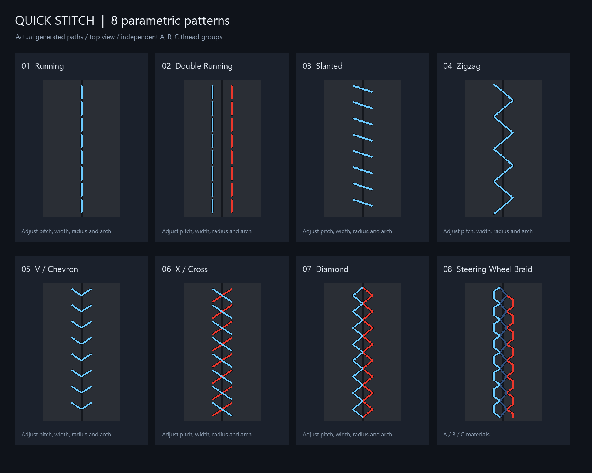

# Quick Stitch Pro V1.0

Original custom stitches plus eight parametric patterns for Cinema 4D (2024–2027).
Author: **Zachary Shee** (based on Quick Stitch by Nishiki, MIT License).
See [使用说明](使用说明.md) for the Chinese installation and parameter guide.

A free plugin for Cinema4D to easily and quickly create stitches.

# Installing

Put this folder, including **`quick_stitch.pyp`, `quick_stitch_patterns.py`, and `res`**, in C4D's plugin folder,
then restart Cinema 4D. Keep only one installed Quick Stitch version: the plugin
ID remains `1054816` so existing scenes retain their object type. Another `.pyp`
or encrypted `.pypv` version using that ID must be moved out of the plugin search
paths before installing this version.

`quick_stitch_original_py2.pyp.bak` preserves the original source for reference.
Keep the `.bak` suffix so Cinema 4D does not execute it as a second plugin.

# Usage

Youtube Link:
https://youtu.be/tS6OjRC7nik

1. Create a **Quick Stitch Pro** object and link an editable polygon mesh in **Object**.
2. Select edges on that mesh, then click **Make Stitch**. A path spline is created
   under Quick Stitch Pro. Creating or replacing the path supports Undo and Redo.
3. Choose **Stitch Style**. Original / Custom retains the old Shape controls.
   New styles include running, double running, slanted, zigzag, V, X, diamond,
   and three-thread steering-wheel braid.
4. New patterns default to **By Pitch**. Switch to By Count to use Count instead.
   Adjust seam width, length, arch, profile offset, crossing clearance, stagger,
   mirroring, reverse direction and quality. Thickness is the thread radius.
   **Needle Shape > Needle Profile** edits the complete needle's control points
   and tangents, with exactly the original three-knot shape as its default.
5. Enable **Surface Fit** and link an evaluated polygon surface, or leave Surface
   empty to use Object. Choose an up axis for paths without a fitting surface.
6. Assign thread materials in A/B/C. Preview colors affect the editor only.
   Use the same material in multiple slots for single-color stitching.
7. Open the **About / 关于** tab to view plugin/version/author information or switch
   **Language** between **Auto (Follow C4D)**, **English**, and **简体中文**.
   Language changes take effect immediately in the Attribute Manager and persist
   across sessions. New objects inherit the last explicit language choice without
   resetting that preference. Changing only the language reuses the existing
   geometry cache; geometry, path, surface and material edits still update normally.

An editable or primitive spline can also be placed directly under QuickStitch.
The first direct spline child is the path; unrelated children are skipped and
preserved. Changes to that path invalidate the generated cache. Edge extraction
is a snapshot: click **Make Stitch** again after changing the source mesh or its
edge selection. Invalid button input is reported in the status bar and console.

# Compatibility fixes

- Accept both the older Init call and the clone-initialization argument added
  in Cinema 4D 2024; preserve copied parameters during clone initialization.
- Convert selected edges on a temporary mesh copy with an explicit modeling
  container. Parent the new path before setting its world matrix.
- Read the current Object link at button-click time. Validate the mesh and edge
  selection before changing an existing path or opening an undo operation.
- Build generated objects locally and keep their path link inside the returned
  hierarchy, avoiding persistent references to another object's cache or path.
- Track spline geometry, transform, and cache changes. Return an empty Null for
  missing input instead of repeatedly requesting an invalid cache.
- Fall back to the default icon and log a warning when the bitmap cannot load.

# Regression checks

Run `tests/c4d_patterns.py` (includes the legacy suite) from Cinema 4D's Script Manager, or execute it with
C4D's embedded Python. The checks use detached temporary documents and do not
register a plugin, replace an installed version, edit the active scene, or change
the user's saved language preference.

The runner reads parameter IDs from this project's header. Most checks use a
disabled native Python Generator as a parameter host and exercise the workspace
source directly, including real edge conversion, world transforms, Undo/Redo,
copied paths, and native Sweep/Cloner evaluation. Direct calls force cache
rebuilding because they do not supply the internal hierarchy-help capsule.

An additional enabled Python Generator calls the same implementation with a real
native hierarchy-help capsule and matching cache settings. It checks updates
after parameter and spline-point changes, including subsequent clean evaluations.
Language checks cover initialization callbacks, cache reuse for both the original
and new styles, and simultaneous geometry, material and dependency changes.
Installing the plugin and restarting C4D is still needed to verify plugin startup
and actual ObjectData registration for a particular C4D release.

# Pattern details

Closed paths fit the repeat interval to their length. Closed zigzag patterns
use even repeat counts to preserve the alternating left/right placement. Count is
distributed across disconnected path segments; open paths keep the requested pitch.
Surface projection failures return empty output and a console message rather than
partial floating threads. New patterns are limited to 4096 repeats and 300000 path
samples; reduce detail/count or increase pitch for larger scenes.

`examples/Quick_Stitch_Styles.c4d` is a portable native geometry snapshot with the
eight patterns, a fitted cylinder, and a fitted steering-wheel torus. It contains
native sweeps and paths rather than a live custom plugin object. The PNG atlas is
an orthographic drawing of the generated curves, not a leather material render.

The new styles model visible thread paths. Needle holes, leather dents and cloth
simulation are outside this version. Original code and attribution remain in the
source header, with the untouched Python 2 source preserved in the .bak file.

# Needle arc / percentage correction

All eight new styles consist of independent open needles in each material group.
The editable Needle Profile controls every needle from its first point to its
last point, with no appended entry segments. End pieces on open paths are clipped
before their complete profile is placed. All patterns use
at least four base steps (eight by default), with extra samples at control points and bends.
V shapes are split into two needles, while zigzag and diamond
patterns use one needle per edge. X shapes retain two complete diagonals with
Crossing Clearance at their actual intersection. Original / Custom is unchanged.
Surface-fitted Profile Offset follows the skin normal even when layout rotation is set.

The percentage resource limits are in displayed units: 0..100 for start offset
and 5..95 for slant/stagger, with a one-percent step. The ObjectData
description also enforces their corresponding normalized 0..1 ranges. Previously
saved clamped values are retained; reset stagger to 50% when
checking an object created with the initial pattern version.

The native side-view examples are in examples/Braid_Independent_Arcs.c4d;
examples/braid_side_preview.png shows the generated Sweep mesh and exact
single-piece profiles for three arch heights.
examples/All_Styles_Independent_Arcs.c4d and examples/all_styles_side_preview.png
show native mesh and needle profiles for every new style.

# Editable needle profiles

The **Needle Shape** group contains an independent native spline
editor for all eight new styles. Its default uses exactly the same positions,
tangents and knot flags as Original / Custom. The original Shape field and old
scene parameters remain separate. Existing new-style objects without a stored
profile also use the original default; importing them initializes the editor.

Profile X controls position along the entire needle. Profile Y is multiplied by
Needle Arch Height; Profile Offset then translates the complete curve relative
to the surface. The default endpoints have Y=0 and the crown has Y=1. Both points
and tangents scale with height. On a plane, zero arch produces a straight needle
(X's explicit crossing clearance still separates its upper thread). Thickness
only changes the thread radius, without automatically lifting its centerline.

Edit points and tangent handles to control both ends and the crown, including
asymmetric profiles. The editor displays X=0..1 and Y=0..1, with zero at the bottom
and the original default curve filling the view. Older -1..1 display ranges are
updated without rescaling points or tangents. Linear and cubic editor
interpolation are supported. Profiles must progress left to right within X=0..1.
Moving an endpoint along X changes its actual position; no tail is appended.

**Profile Offset** is signed and defaults to zero: positive lifts the full
centerline, negative lowers it. The intersection of that curve and the skin
determines which part is buried. To hide an entire tube end, account for its
radius when adjusting the curve or offset. Crossing Clearance continues to add
local separation at the actual X intersection without altering either endpoint.

Choose Original Shape, Rounded Arch, Low Arch or Straight in **Profile Preset**
to apply it immediately. There is no Apply/Reset button. Manual curve edits show
**Custom**; selecting a named preset replaces that curve. Cinema 4D's normal Undo
restores the previous curve and preset together. Loading a scene preserves its
saved curve rather than reapplying the displayed preset.
Entry Depth, Entry Transition and Needle Curve Roundness are removed from the
interface and generation logic. Their old IDs are reserved and stored values
are ignored. The former Surface Clearance value is retained as Profile Offset;
the extra radius-based lift is removed. Original / Custom remains unchanged.

`examples/Needle_Profile_Controls.c4d` and `examples/needle_profile_controls.png`
compare normal, low and zero arch, a translated full curve, and edits to tangents
and control points. Orange samples show an original native Bezier reference.
The scene also contains native reference sweeps beside the generated needles.

# Default mesh density

New objects default to **Curve Detail = 8** and **Thread Profile Detail = 1**.
The latter produces an approximately eight-sided circular cross section, matching
the original plugin. Curve Detail allows 4..48; Thread Profile Detail allows 1..32.
Lower curve settings now also relax adaptive refinement, while settings of 12
and above retain their previous precision. Path-frame precision and the Surface
Fit algorithm are unchanged.

Existing objects retain their saved quality settings. Set the two fields to 8
and 1 to use the new defaults on an existing object. In a 100-needle straight-path
comparison with matching dimensions, the new defaults produced 11,800 polygons
versus 10,800 with the original structure; the previous defaults produced about
120,000. Higher quality remains available when needed.
